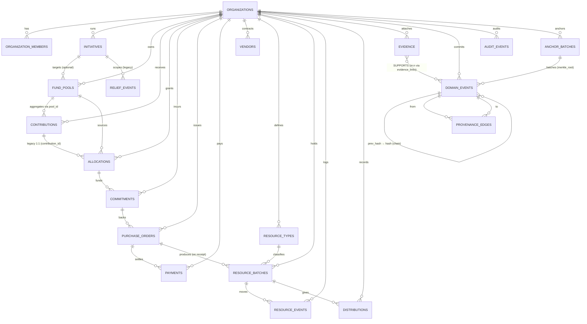

# ImpactLedger — Entity Relationship Diagram

Source of truth: `IMPACTLEDGER_RULEBOOK_v1.0.md`.
This ERD is the concrete implementation of the rulebook's entity vocabulary. Every
tenant-owned entity carries `organization_id`; every write path is guarded by
RLS (`supabase/migrations/020_rls_policies.sql`).

## Legend

- `PK` — primary key
- `FK` — foreign key
- `(org)` — participates in a composite `(id, organization_id)` FK to enforce
  cross-tenant integrity (see migration 010)
- `imm` — row is treated as immutable once inserted (no UPDATE / DELETE from
  application code; enforced by trigger)

## Diagram

## Table summary

### Identity & tenancy

| Table                  | PK    | Notes                                                              |
|------------------------|-------|--------------------------------------------------------------------|
| `organizations`        | UUID  | Lifecycle (`DRAFT → PENDING_VERIFICATION → VERIFIED → ACTIVE → SUSPENDED → CLOSED`) added in `013`. |
| `organization_members` | UUID  | `(organization_id, user_id)` unique; role enum from `002`.         |
| `initiatives`          | UUID  | Added in `011`. `DRAFT → ACTIVE → CLOSING → CLOSED`.               |

### Financial

| Table              | PK   | Key FKs                                                       | Immutable? |
|--------------------|------|---------------------------------------------------------------|-----------:|
| `fund_pools`       | UUID | `organization_id`, optional `initiative_id`                   | no         |
| `contributions`    | UUID | `organization_id`, `fund_pool_id?`, `contributor_user_id?`    | commit-imm |
| `allocations`      | UUID | `organization_id`, `fund_pool_id?`, `initiative_id?`, `purpose_category?` | commit-imm |
| `commitments`      | UUID | `organization_id`, `allocation_id`, `vendor_id?`              | commit-imm |
| `vendors`          | UUID | `organization_id`                                             | no         |
| `purchase_orders`  | UUID | `organization_id`, `commitment_id`, `vendor_id`               | commit-imm |
| `payments`         | UUID | `organization_id`, `purchase_order_id`, `commitment_id?`      | commit-imm |

"commit-imm" = INSERT once, then locked by row trigger; only ADR-006 corrections
add a new event with `CORRECTS`/`REVERSES` provenance.

### Physical

| Table              | PK   | Key FKs                                                       |
|--------------------|------|---------------------------------------------------------------|
| `resource_types`   | UUID | `organization_id`; unique `(org, name)`                       |
| `resource_batches` | UUID | `organization_id`, `resource_type_id`, `purchase_order_id?`   |
| `resource_events`  | UUID | `resource_batch_id`; type enum RECEIVED/TRANSFER/DISPATCH/DELIVERY/DISTRIBUTED/DAMAGED/LOST/DISPOSED/ADJUSTED |
| `relief_events`    | UUID | Kept for backward-compat with existing routers. Superseded by `initiatives` for new work; the two coexist. |
| `distributions`    | UUID | `relief_event_id`, `resource_batch_id`                        |

### Evidence, provenance, audit, anchoring

| Table                | PK   | Notes                                                                        |
|----------------------|------|------------------------------------------------------------------------------|
| `evidence`           | UUID | Off-chain file in Supabase Storage; row stores `content_sha256`, MIME, status |
| `evidence_links`     | UUID | m:n between `evidence` and `domain_events`                                    |
| `domain_events`      | UUID | Immutable log. `hash = SHA256(canonical_json)`. `prev_hash` per org.         |
| `provenance_edges`   | UUID | `from_event → to_event` with relation enum (`DERIVED_FROM`, `FULFILLS`, `ALLOCATES_FROM`, `AFFECTS`, `CORRECTS`, `REVERSES`, `REFERENCES`). |
| `audit_events`       | UUID | System actions (login, denied auth, admin actions); separate from domain log. |
| `anchor_batches`     | UUID | `merkle_root`, `event_count`, `status` (`PENDING → SUBMITTED → CONFIRMED → FAILED`), `chain_id`, `tx_hash?`, `block_number?`. |
| `anchor_batch_items` | UUID | Junction: which `domain_events` belong to which `anchor_batch`.               |

## Cross-tenant integrity

Every child FK to a tenant-owned parent uses the composite `(id, organization_id)`
pattern established in migration `010`. New tables in migrations 011–019 follow
the same rule (see `010_harden_tenant_foreign_keys.sql` for the canonical
example). This makes it impossible for a malicious or buggy client to reference
another org's row even if it slips past application checks.

## Public projection

`public_initiative_summary` (view, migration `021`) exposes only sanitized
aggregates: totals, remaining amounts, quantity in/out, reconciliation status,
and material discrepancies. PII, bank details, private evidence bytes, and
internal notes are excluded by construction.

## Invariants (deterministic; enforced in `apps/api/app/domain/invariants.py`)

Financial (rulebook §7):

1. `sum(allocations.amount for pool) <= sum(contributions.amount for pool)`
2. Restricted funds cannot flow to disallowed purposes.
3. `sum(commitments.amount for allocation) <= allocation.amount`
4. `sum(payments.amount for PO) <= PO.total_amount` unless an explicit exception event exists.
5. `sum(refunds.amount for payment) <= payment.amount`
6. Corrections reference an existing event.
7. Reversals reference a valid prior event.
8. Committed events do not UPDATE / DELETE.
9. All balances derived from event history.

Physical (rulebook §8):

1. `resource_batches.quantity >= 0` at all times.
2. Transfers, dispatches, deliveries, distributions cannot exceed available quantity at the source.
3. Received = Distributed + Transferred + In-Transit + Remaining + Lost + Disposed.
